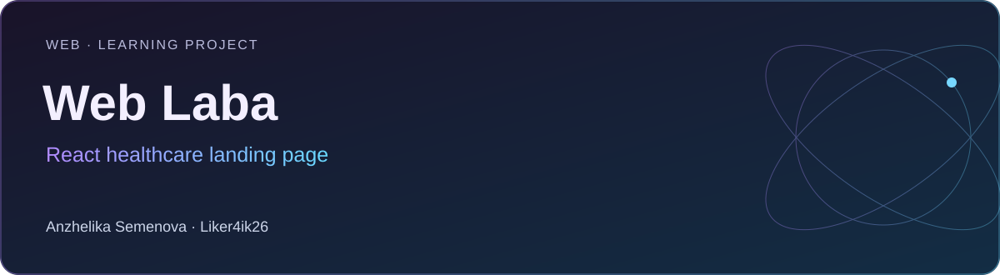
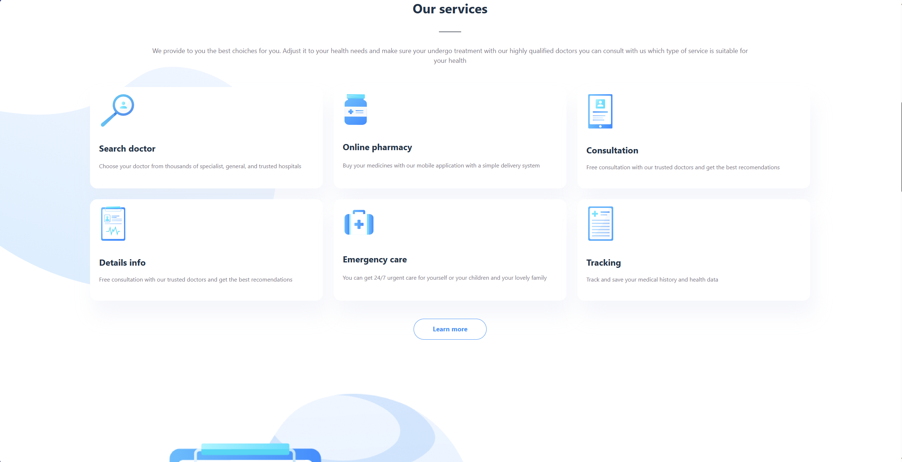
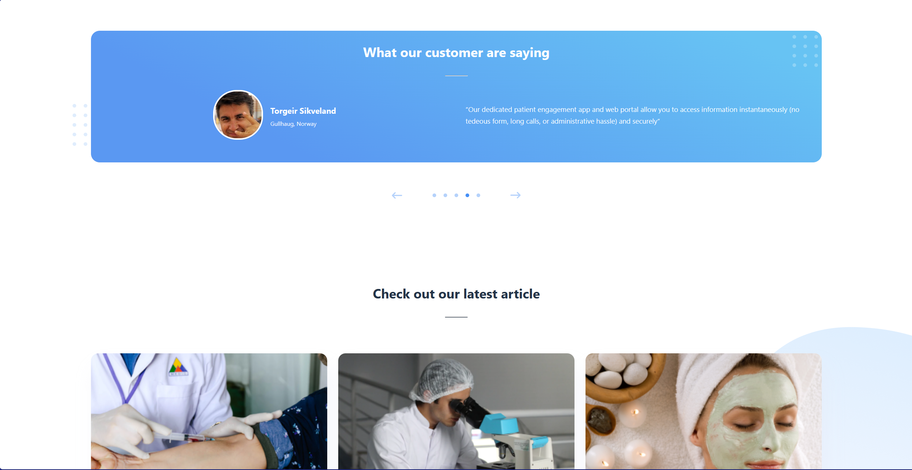

# Web Laba

**Web · Learning project** · React 18 · TypeScript · Vite 5 · SCSS · React Router

Учебный сайт медицинских услуг: главная страница с сервисными карточками, отзывами, статьями и навигацией.

[Портфолио автора](https://portfolio.semenova-anzhelika.online/) · [Профиль GitHub](https://github.com/Liker4ik26) · [Исходники](https://github.com/Liker4ik26/weblaba/tree/master)

> Ветка main содержит описание. Полный веб-проект находится в master; команда запуска выбирает master.

## Как выглядит проект

| Интерфейс | Сценарии |
| :---: | :---: |
| <br/>Экран 1 | <br/>Экран 2 |
| <br/>Экран 3 | <br/>Экран 4 |

[Все изображения проекта](docs/GALLERY.md)

## Что в проекте

- Главная страница и карточки медицинских услуг.
- Навигация, отзывы, статьи и footer.
- Компонентная структура на React и стили на SCSS.

## Технологии

| Направление | Реализация |
| :--- | :--- |
| Стек | React 18 · TypeScript · Vite 5 · SCSS · React Router |
| Формат | Web · Learning project |
| Окружение | Node.js 18+ и npm (Vite 5) |

## Как запустить

Требования: Node.js 18+ и npm (Vite 5).

```bash
git clone --branch master https://github.com/Liker4ik26/weblaba.git
cd weblaba
npm ci
npm run dev
```

Для сборки: `npm run build`. Node.js должен поддерживать Vite 5 (Node 18+).

## English overview

**Web Laba — React healthcare landing page.**

Web · Learning project. Stack: React 18 · TypeScript · Vite 5 · SCSS · React Router. The full application source is in the `master` branch. [Explore my professional portfolio](https://portfolio.semenova-anzhelika.online/).

---

**Автор — Анжелика Семёнова · [Liker4ik26](https://github.com/Liker4ik26)**

[Сайт](https://portfolio.semenova-anzhelika.online/) · [Telegram](https://t.me/Liker4ik50) · [Почта](mailto:pr110oat18@gmail.com)
